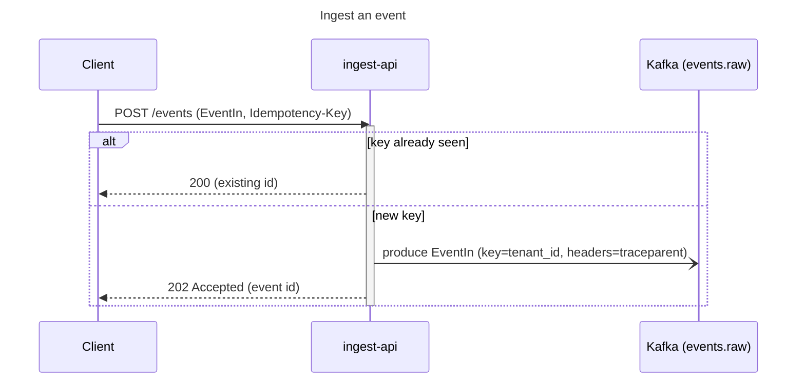

# UML and C4 diagrams as code

Diagrams are code: Mermaid inside Markdown, versioned, reviewed and kept in sync in the same PR as the change.

## Which diagram
| Question | Diagram | Mermaid |
|---|---|---|
| What is the system and who uses it? | C4 System Context | `C4Context` |
| Which deployable parts are there, and how do they talk? | C4 Container | `C4Container` |
| What's inside one service? | C4 Component, or UML component | `C4Component` / `flowchart` |
| How does a request or event flow over time? | UML sequence | `sequenceDiagram` |
| What states can an entity or agent be in? | UML state machine | `stateDiagram-v2` |
| How are the domain types related? | UML class | `classDiagram` |
| Where does it run? | UML deployment / C4 Deployment | `C4Deployment` / `flowchart` |
| What's the workflow, including branches? | UML activity | `flowchart` |

## Where diagrams live
- `docs/architecture/` for C4 context and container diagrams, inside the arc42 sections
- `openspec/changes/<id>/design.md` for diagrams of a proposed change
- A service's `README.md` for its component, sequence and state diagrams

## Conventions
- Each diagram gets a title, and one sentence before it that says what question it answers.
- Use names from the code (services, topics, classes). Label arrows with the protocol and payload: `POST /events (EventIn)`, `produce events.raw`.
- Sequence diagrams show async boundaries explicitly: `-)` for async messages, plus `activate` and `deactivate`.
- Keep each diagram to about 12 elements. Split rather than cram.
- Show the failure paths that matter (`alt`/`opt` blocks for retries, DLQ, timeouts).

## Example: event ingest (sequence)

## Checklist before finishing
- Does it render? Check with Mermaid syntax, or the `mmdc` CLI if available.
- Does it match the code and spec in this PR?
- Is any older diagram now stale? Update it in the same PR.
